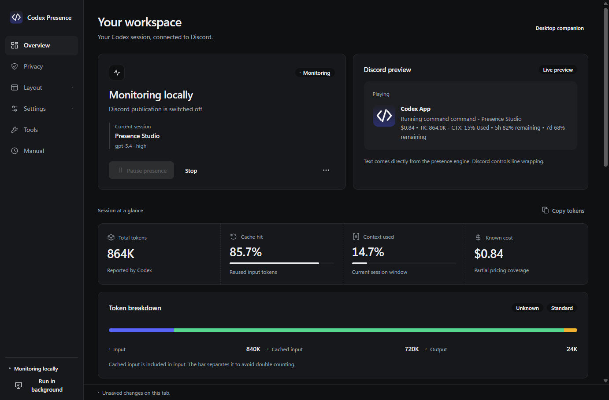
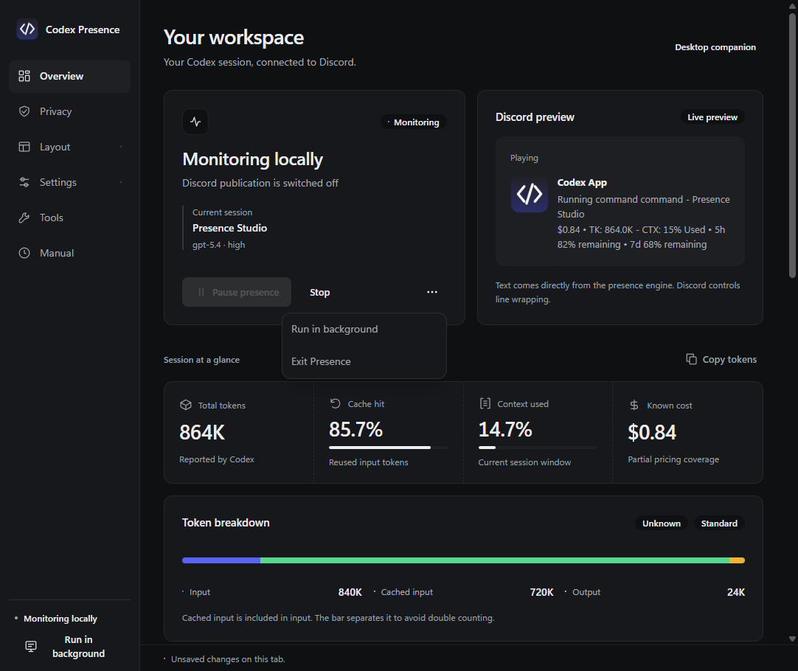
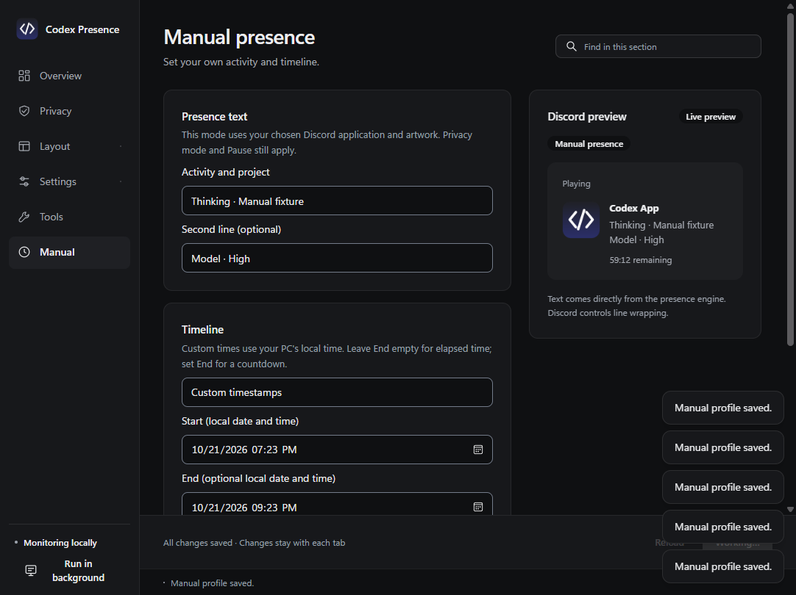

# Desktop 3.1 verification

The daisyUI workspace keeps existing automatic presence composition, configuration and preferences intact. Manual presence is an explicit alternate mode with its own profile sidecar. Its active state is never persisted. There are no new runtime dependencies or bot-token requirements.

## Checks

- 306 Rust tests, formatting and strict all-feature Clippy.
- 119 browser integration checks: every native control across six sections; draft/save behavior; exact automatic preview strings; caret retention; five manual timestamp modes through actual browser inputs and actions; profile save; startup-gate retention; app priority; restart behavior; top-layer menu hit testing; expanding panels; native resize gutter; deferred resize updates; maximized work-area bounds; four browser zoom levels; dark/light/styles; high contrast/reduced motion; and external-navigation blocking.
- 596 native checks across drives, including all existing startup, privacy, configuration, timers, priority, layout and diagnostic behavior. The former fixed-width assertion now checks that content grows with the available window.
- Actual Windows corner drag to a compact window and maximize were exercised in a synthetic, local-only verification session. No manual fixture activity was published to Discord.

The maximized-window handler uses the current monitor's working area with Windows' [WM_GETMINMAXINFO contract](https://learn.microsoft.com/en-us/windows/win32/winmsg/wm-getminmaxinfo), retaining minimum track size in physical pixels. The browser leaves an 8px native gutter; collapsed native views stop doing duplicate layout, and drag-time snapshot refreshes and geometry writes are deferred until the drag ends.

## Screenshots

All screenshots contain synthetic sessions, not personal chats.

## Limits

Browser zoom checks cover 100/125/150/200 percent. Physical mixed-DPI monitor transitions, Windows 10 and a full screen-reader session have not been verified. Manual Discord payload fields and timestamps are verified through serialization and the observe-only bridge; a user's actual Discord card has not been used as a manual-mode test. Existing automatic preview strings are regression checked unchanged.

No design approval remains pending for these requested changes.
